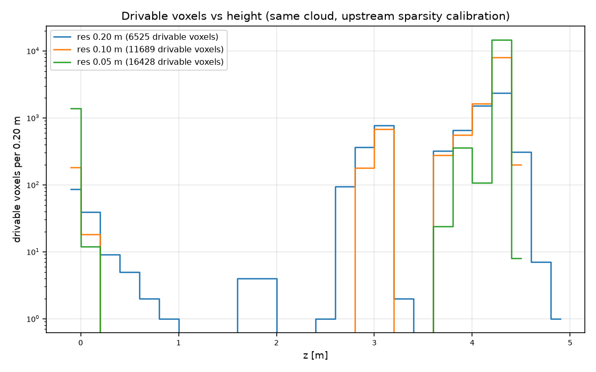
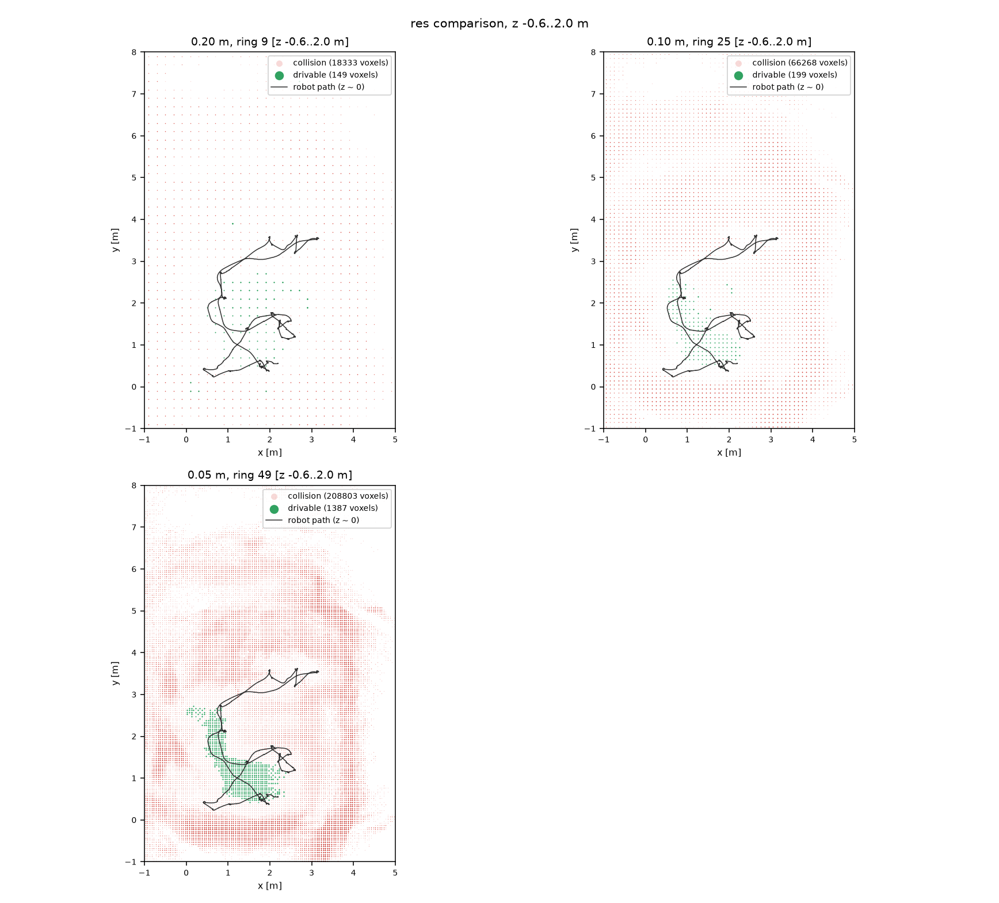
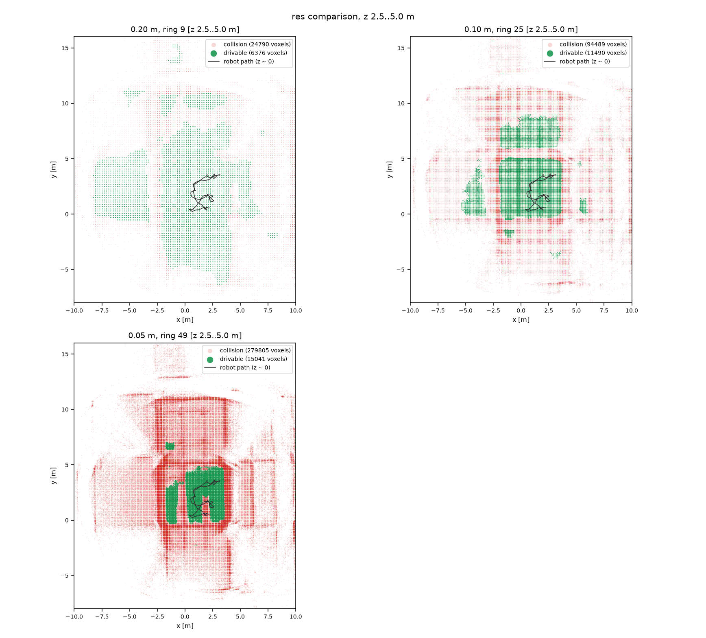
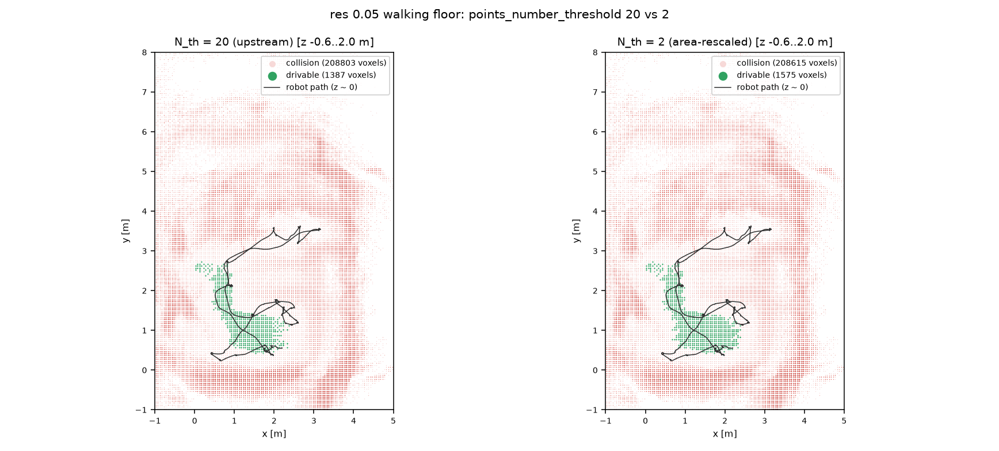
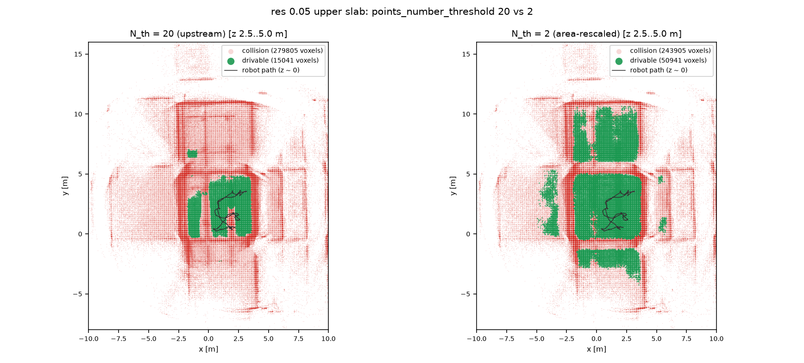
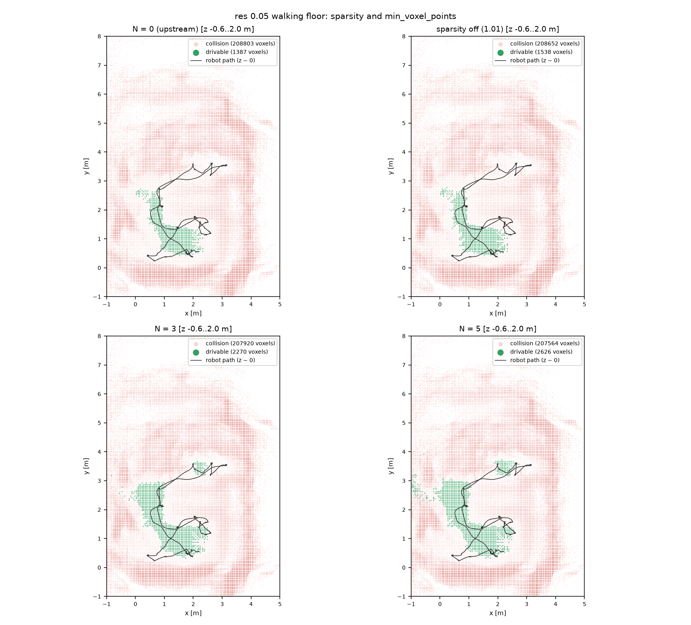
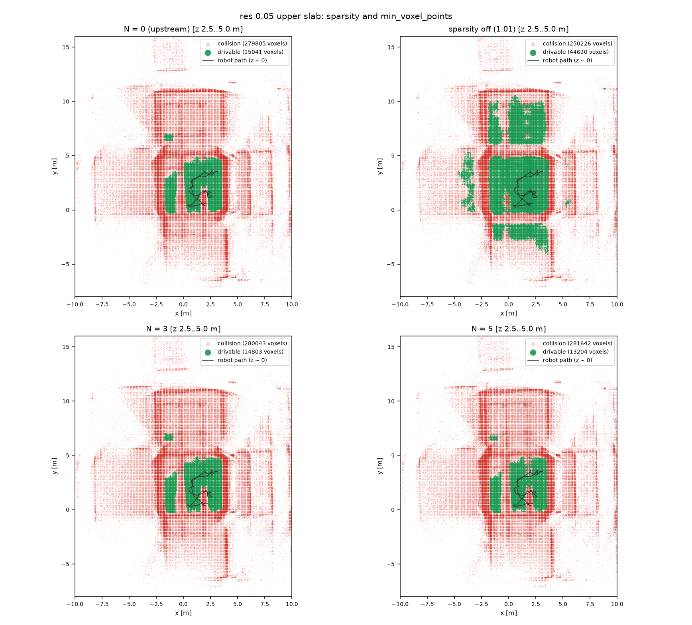

# 分辨率 × 点云密度：可通行体素与处理时间（数据与检验）

> 数据集：`rosbag2_2026_10_28-15_57_50`（122 s，1220 帧 `/cloud_registered_body` ≈ 10 Hz，
> 24 402 条 `/localization_pose`）
> 实现：`finenav_retap`（ReTAP 地形分析移植到 FineNav-Engine，在线 `RetapTerrainMap`）
> 日期：2026-10-31　·　同一台笔记本，单进程运行
>
> **本报告的组织**：§1–§6 只放数据——口径、配置、原始表格、图、复现命令；
> §7 起才是分析。表格与图的每个数都能用 §6 的命令重跑，建议先读完 §1–§6，
> 再对照 §7 检验这些结论。

---

## 1. 数据与口径

### 1.1 数据集与话题

| 用途 | 话题 | 说明 |
|---|---|---|
| 位姿（全局） | `/localization_pose` | `map ← base_link` 绝对位姿，localizer 的 `pose_topic` |
| 扫描点云 | `/cloud_registered_body` | FAST-LIO 去畸变点云，**base_link 系**；地图插件用扫描时间戳处的插值位姿旋转到 `map` |
| TF | `/tf`、`/tf_static` | 完整录了；数据路径**不查询** TF（回放时 stamp 会"未来外推"），仅供 RViz 显示 |

机器人在 `map` 系里的轨迹范围：x 0.41–3.17 m、y 0.23–3.63 m、z −0.011–0.031 m。

### 1.2 配置

每行配置的体积参数（`collision_neighbor` 编码 `1+8R`，横向半跨 = (R+0.5)·res；
`clearance_voxels` 是正上方硬阻挡层；`support_voxels: 3` 是所有行共用的向下 4 层窗口）：

| res | 配置文件 | ring (R) | 横向半跨 | `clearance_voxels` | `support_voxels` | `points_number_threshold` | `min_voxel_points` |
|---|---|---|---|---|---|---|---|
| 0.20 | `terrain_res020_ring09.yaml` | 9 (1) | 0.30 m | 4 (0.80 m) | 3 | 20 | 0 |
| 0.10 | `terrain_res010_ring25.yaml` | 25 (3) | 0.35 m | 7 (0.70 m) | 3 | 20 | 0 |
| 0.05 | `terrain_res005_ring49.yaml` | 49 (6) | 0.325 m | 13 (0.65 m) | 3 | 20 | 0 |
| 0.05 | `..._sparsity_off.yaml` | 49 | 0.325 m | 13 | 3 | 20 | 0（`sparsity_threshold: 1.01`） |
| 0.05 | `..._n3.yaml` / `..._n5.yaml` | 49 | 0.325 m | 13 | 3 | 20 | 3 / 5 |
| 0.05 | `..._pnt2.yaml` | 49 | 0.325 m | 13 | 3 | **2** | 0 |

四个地形硬阈值与权重在所有行保持不变（slugcat 标定：slope 0.65、roughness 0.50、
sparsity 0.70、traversability 0.805；权重 0.5 / 0.3 / 0.2，`w_T = 2.3`）。

> 关于"N=1.01"：请求里的 1.01 指的是 **`sparsity_threshold: 1.01`**（稀疏度上限为 1.0，
> 等于关闭这一条硬约束），不是 `min_voxel_points`。本报告把它单独列成一行并明确标注。

### 1.3 指标定义

| 指标 | 定义 |
|---|---|
| 总体素 | 地图中被占据的体素数（octomap 叶子节点 `isNodeOccupied()` 为真者） |
| 可通行体素 | `getCollision() == false` 的占据体素——地形硬约束与邻域净空/支撑都通过 |
| 占比 | 可通行 / 总体素 |
| 面积 | 可通行体素 × res²（把每个体素当作 res² 的地面面积） |
| ms/帧 | 地图节点在一次更新批里"插入 + 地形分析"的墙钟时间 ÷ 该批融合的帧数，取自进程退出时打印的 `RetapTerrainMap: final ...` 一行 |
| 轨迹 passable | 24 402 个位姿去重成体素格（分母 97 / 218 / 470），每格从位姿上方 0.2 m 向下扫 0.6 m，**第一个占据体素**视为地面；该体素 `collision == false` 记 passable |

口径上的两条事实（不是结论，是定义带来的性质）：

1. **面积不区分高度层**。一个体素只要 `collision == false` 就计入面积，不论它在
   z ≈ 0 还是 z ≈ 4.3。§4 会把这个混合拆开。
2. **轨迹 passable 只探地面**。它从机器人位姿向下扫，所以它读的是 z ≈ 0 那一层，
   与面积口径覆盖的体素集合不同。

### 1.4 两个回放协议

第一版表格用的是"把包按 1.0 倍速放完，能算多少算多少"。结果是：
**res 0.20 融合 1220 帧、0.10 只融合 1055 帧、0.05 只融合 891 帧**（73%–86%）。
原因是地形分析的成本超过了数据到达率，而运行时观测缓冲
（`ObservationBufferPolicy.max_buffer_size: 2`）会把来不及分析的帧**静默丢弃**——
插件自己的 `dropped` 计数只统计自己的队列，所以日志里的 "dropped 0" 并不代表没丢。

因此本报告区分两个协议：

| | **协议 A：保真回放** | **协议 B：等输入** |
|---|---|---|
| `bag_rate` | 1.0（与录制同速） | 0.4 / 0.12（低于实测吞吐的 ~80%） |
| 每一行融合的帧数 | 由算力决定（1220 / 1055 / 891） | 必须接近全部 1220 帧 |
| 回答的问题 | "这个配置能不能实时跑这份数据" | "同样的输入，分辨率本身改变了什么" |
| 用途 | §5 吞吐结论 | §2、§3 的全部质量指标 |

协议 B 的脚本会自己从 bag 里读出 `/cloud_registered_body` 的帧数，并与地图节点报告的
`processed` 对比；低于 98% 直接判该行**不可比较**。实测 7 行的融合帧数是 1201–1220 / 1220
（98.4%–100%）。缺的 4–19 帧不是算力不足，而是上游 fuser 打印
`ObservationSource 'lidar': no robot state available at stamp ... — message dropped`
丢掉的（回放路径的 ~1% 属性，散布在整段录制里，不是启动瞬态）。

---

## 2. 表 1：在线增量（协议 B，`retap_rosbag.launch.py` 可复现）

| # | 配置 | res | 关键改动 | `bag_rate` | 融合帧 | 总体素 | 可通行体素 | 占比 | 面积 (m²) | ms/帧 |
|---|---|---|---|---|---|---|---|---|---|---|
| 1 | `terrain_res020_ring09` | 0.20 | 基准 | 1.0 | 1220/1220 | 28 810 | 4 893 | 16.98% | 195.72 | 29.04 |
| 2 | `terrain_res010_ring25` | 0.10 | 基准 | 0.4 | 1216/1220 | 119 042 | 10 274 | 8.63% | 102.74 | 114.92 |
| 3 | `terrain_res005_ring49` | 0.05 | 基准（N=0，N_th=20） | 0.12 | 1205/1220 | 383 972 | 15 992 | 4.16% | 39.98 | 621.50 |
| 4 | `..._sparsity_off` | 0.05 | `sparsity_threshold: 1.01` | 0.12 | 1205/1220 | 383 050 | 34 435 | 8.99% | 86.09 | 671.30 |
| 5 | `..._n3` | 0.05 | N = 3 | 0.12 | 1201/1220 | 382 866 | 16 441 | 4.29% | 41.10 | 628.87 |
| 6 | `..._n5` | 0.05 | N = 5 | 0.12 | 1206/1220 | 383 441 | 15 506 | 4.04% | 38.77 | 629.91 |
| 7 | `..._pnt2` | 0.05 | `points_number_threshold: 2` | 0.12 | 1207/1220 | 384 171 | 39 575 | 10.30% | 98.94 | 672.46 |

在线路径有 free 射线清空（`update_free: 2`、`max_range: 7`），所以总体素比离线低；
两个表各自内部可比，不要混着比。

**在线地图没有导出成 PCD，所以 §4 的分层统计只覆盖离线表。**

---

## 3. 表 2：离线整包分析（`retap_map_tool analyze`，同一份点云）

离线路径把 1220 帧全部旋转到 `map` 后累积成一份 3 971 000 点的 PCD（`demo/scripts/bag2pcd.py`），
一次 `insertCloud + evaluateAll` 分析。它**没有 free 射线清空**（`update_free: 0`），
所以远距离一次性噪声比在线多，总体素比在线高（0.20 m：57 917 vs 28 810）。

| 配置 | res | 总体素 | 可通行体素 | 占比 | 面积 (m²) | load (ms) | insert (ms) | analysis (ms) | 轨迹 passable |
|---|---|---|---|---|---|---|---|---|---|
| `res020_ring09` | 0.20 | 57 917 | 6 525 | 11.27% | 261.00 | 62.3 | 233.5 | 458.6 | 38/97 = 39.18% |
| `res010_ring25` | 0.10 | 191 128 | 11 689 | 6.12% | 116.89 | 62.2 | 455.3 | 1 595.3 | 67/218 = 30.73% |
| `res005_ring49` | 0.05 | 540 895 | 16 428 | 3.04% | 41.07 | 61.9 | 1 059.8 | 4 831.8 | 151/470 = 32.13% |
| `..._sparsity_off` | 0.05 | 540 895 | 46 158 | 8.53% | 115.40 | 75.2 | 1 220.7 | 7 163.8 | 160/470 = 34.04% |
| `..._n3` | 0.05 | 540 895 | 17 073 | 3.16% | 42.68 | 62.8 | 1 049.5 | 4 961.7 | 215/470 = 45.74% |
| `..._n5` | 0.05 | 540 895 | 15 830 | 2.93% | 39.58 | 74.8 | 1 220.5 | 6 294.0 | 240/470 = 51.06% |
| `..._pnt2` | 0.05 | 540 895 | 52 516 | 9.71% | 131.29 | 75.7 | 1 225.4 | 7 412.1 | 162/470 = 34.47% |

分母随 res 变（97 / 218 / 470 格），所以轨迹这一列只比百分比，不比绝对数。

---

## 4. 地图里有两层水平面：按 z 切开

### 4.1 z 剖面



图的读法：横轴 z、纵轴每个 0.20 m 高度带里的**可通行体素数**（对数坐标，因为两层差了
一个量级）。三条曲线对应 res 0.20 / 0.10 / 0.05，同一份累积点云、上游标定。
可通行体素集中在两段：z ≈ 0（行走地面）与 z ≈ 2.7–4.7（上方板层，主体在 3.9–4.5；
代码里按 z ∈ [2.5, 5.0] 统计）。
两段之间（z 1–2.5）基本为空。对数坐标是必要的：线性坐标下 z ≈ 0 那一根柱子几乎看不见。

### 4.2 分层计数

同一份点云、同一套体素格；"该层占据体素"来自原始点云体素化（`retap_density.py`），
"该层可通行"来自 `.bt`（`retap_bands.py`）。两者的总数逐位相同
（57 917 / 191 128 / 540 895），所以可以直接并列：

| res | 层 | z 区间 | 该层占据体素 | 该层可通行 | 该层可通行占该层比 | 面积 (m²) | 占全部可通行体素 |
|---|---|---|---|---|---|---|---|
| 0.20 | 地面 | [−0.6, 2.0) | 18 482 | 149 | 0.81% | 5.96 | 2.3% |
| 0.20 | 上方板层 | [2.5, 5.0] | 31 166 | 6 376 | 20.46% | 255.04 | 97.7% |
| 0.10 | 地面 | [−0.6, 2.0) | 66 467 | 199 | 0.30% | 1.99 | 1.7% |
| 0.10 | 上方板层 | [2.5, 5.0] | 105 979 | 11 490 | 10.84% | 114.90 | 98.3% |
| 0.05 | 地面 | [−0.6, 2.0) | 210 190 | 1 387 | 0.66% | 3.47 | 8.4% |
| 0.05 | 上方板层 | [2.5, 5.0] | 294 846 | 15 041 | 5.10% | 37.60 | 91.6% |

两层之外的占据体素（z ∈ [2.0, 2.5) 与 z ∉ [−0.6, 5.0]，主要是墙面）不含任何可通行体素，
三行的 `other` 都是 0。因此"地面面积 + 板层面积 = 表 2 的面积"，逐行相等
（5.96 + 255.04 = 261.00；1.99 + 114.90 = 116.89；3.47 + 37.60 = 41.07）。

### 4.3 分层图：三种分辨率

俯视图会把上下两层叠在一起，所以每张图只保留一个 z 窗口。
绿 = 可通行体素，红（半透明）= 碰撞体素，黑线 = 录制轨迹（轨迹在 z ≈ 0，画在板层图里只作定位参考）。

**行走地面（z −0.6–2.0 m）**，三张图共用 extent x[−1,5] y[−1,8]：



**上方板层（z 2.5–5.0 m）**，共用 extent x[−10,10] y[−8,16]：



### 4.4 每层的点数分布

`IgTree` 每个体素存 NDT 点数（上限 30）。`retap_density.py` 把累积点云按 res 体素化，
按体素中心高度分层；`ALL` 行与 `retap_map_tool info --histogram` 的输出逐项相同
（32.8/60.4/78.2/21.8 等），可作为分层的校验。

| res | 层 | 体素 | 平均点数 | =1 点 | ≤5 | ≤19 | >19 |
|---|---|---|---|---|---|---|---|
| 0.20 | 地面 | 18 482 | 10.91 | 27.1% | 53.9% | 73.0% | **27.0%** |
| 0.20 | 板层 | 31 166 | 9.84 | 29.5% | 57.8% | 76.8% | **23.2%** |
| 0.20 | 全图 | 57 917 | 9.32 | 32.8% | 60.4% | 78.2% | **21.8%** |
| 0.10 | 地面 | 66 467 | 7.92 | 36.0% | 66.6% | 82.6% | **17.4%** |
| 0.10 | 板层 | 105 979 | 7.09 | 40.3% | 70.5% | 84.9% | **15.1%** |
| 0.10 | 全图 | 191 128 | 7.01 | 41.0% | 70.9% | 85.2% | **14.8%** |
| 0.05 | 地面 | 210 190 | 5.90 | 46.2% | 75.3% | 88.8% | **11.2%** |
| 0.05 | 板层 | 294 846 | 4.53 | 51.7% | 80.4% | 93.2% | **6.8%** |
| 0.05 | 全图 | 540 895 | 4.96 | 50.8% | 79.1% | 91.7% | **8.3%** |

### 4.5 每个 xy 列有几层占据体素

向下的支撑判据要求"下方第 2 层（z = −2）的 8 邻域有占据、第 3 层（z = −3）的 ring 2 有占据"，
层数是这个判据直接看到的东西：

| res | 层 | xy 列数 | 每列占据层数中位数 | ≥2 层 | ≥3 层 | ≥4 层 |
|---|---|---|---|---|---|---|
| 0.20 | 地面 | 4 492 | 3.0 | 68.4% | 54.2% | 44.2% |
| 0.20 | 板层 | 9 267 | 3.0 | 68.6% | 50.3% | 36.2% |
| 0.10 | 地面 | 12 344 | 3.0 | 68.8% | 55.2% | 47.1% |
| 0.10 | 板层 | 28 414 | 2.0 | 68.0% | 45.9% | 34.3% |
| 0.05 | 地面 | 34 770 | 3.0 | 72.6% | 53.7% | 44.2% |
| 0.05 | 板层 | 82 489 | 2.0 | 66.3% | 39.0% | 26.5% |

### 4.6 0.05 m 变体的分层

| 变体 | 地面可通行 | 板层可通行 | 地面面积 (m²) | 板层面积 (m²) | 轨迹 passable |
|---|---|---|---|---|---|
| 基准（N=0，N_th=20） | 1 387 | 15 041 | 3.47 | 37.60 | 151/470 = 32.13% |
| `sparsity_threshold: 1.01` | 1 538 | 44 620 | 3.85 | 111.55 | 160/470 = 34.04% |
| N = 3 | 2 270 | 14 803 | 5.68 | 37.01 | 215/470 = 45.74% |
| N = 5 | 2 626 | 13 204 | 6.57 | 33.01 | 240/470 = 51.06% |
| `points_number_threshold: 2` | 1 575 | 50 941 | 3.94 | 127.35 | 162/470 = 34.47% |

对应图（同样按 z 分层；地面图 extent x[−1,5] y[−1,8]，板层图 extent x[−10,10] y[−8,16]）：

#### `points_number_threshold` 20 vs 2





#### N = 0 / 3 / 5 与关闭稀疏度约束





---

## 5. 吞吐与实时性

### 5.1 协议 A：按录制速度原样回放

| res | 融合帧 | 说明 |
|---|---|---|
| 0.20 | 1220 / 1220 | 算得过来，一帧不丢 |
| 0.10 | 1055 / 1220 | 丢 165 帧（13.5%） |
| 0.05 | 891 / 1220 | 丢 329 帧（27.0%） |

### 5.2 成本随地图增长

平均 ms/帧会低估稳态成本，因为树在长大（日志里的累计平均与对应帧数）：

| res | 起始（帧数） | 中段（帧数） | 结束（帧数） | 末段边际成本 |
|---|---|---|---|---|
| 0.20 | 10.9 ms（2） | 20.9 ms（482） | 29.04 ms（1220） | ≈ 33 ms/帧 |
| 0.10 | 23.1 ms（1） | 49.7 ms（176） | 114.92 ms（1216） | ≈ 160 ms/帧 |
| 0.05 | 191.5 ms（119） | 473.5 ms（533） | 621.50 ms（1205） | ≈ 720 ms/帧 |

数据流是 10 Hz（100 ms/帧预算）：

| res | 平均成本 | 可维持速率 | 能否跟上 10 Hz |
|---|---|---|---|
| 0.20 | 29 ms | ~34 Hz | ✅ 有 3 倍余量 |
| 0.10 | 115 ms（末段 160） | ~6–9 Hz | ⚠️ 需降速或降帧 |
| 0.05 | 621 ms（末段 720） | ~1.4–1.6 Hz | ❌ 差 6–7 倍 |

> 本机是单进程、无 GPU 的笔记本实测值；换机器绝对值会变。

---

## 6. 复现

前置：`colcon build --packages-select finenav_retap --symlink-install`，
`source install/setup.bash`，并保证 workspace 根目录下有且只有一份 `rosbag2_*`。

### 6.1 表 1（在线，7 行，约 40 分钟）

```bash
# 全部 7 行：每行按 "配置:bag_rate" 依次回放、打断、读退出行
demo/scripts/retap_table.sh

# 只跑某一行（同名 yaml + 速率）
demo/scripts/retap_table.sh terrain_res005_ring49_pnt2.yaml:0.12

# 等价的手动调用（脚本内部就是这一条）
ros2 launch finenav_retap retap_rosbag.launch.py \
  config:=terrain_res005_ring49_pnt2.yaml rviz:=false bag_rate:=0.12
```

每次运行的完整日志在 `/tmp/retap_table_XXXX.log`，最后一行即表中的
`scans / occupied / drivable (占比, 面积) / ms per scan`。

### 6.2 表 2（离线）

```bash
# 1) 把 bag 转成 map 系累积点云 + 位姿轨迹（3.97 M 点，24402 位姿）
python3 demo/scripts/bag2pcd.py rosbag2_2026_10_28-15_57_50 /tmp/retap_exp/data

# 2) 每套配置一次分析（秒级），输出 .bt / 各特征点云 / stats.json
for cfg in res020_ring09 res010_ring25 res005_ring49 res005_ring49_sparsity_off \
           res005_ring49_n3 res005_ring49_n5 res005_ring49_pnt2; do
  ros2 run finenav_retap retap_map_tool analyze \
    --pcd /tmp/retap_exp/data/bag_accumulated.pcd \
    --config config/terrain_${cfg}.yaml \
    --output-dir /tmp/retap_exp/cmp_${cfg} \
    --trajectory /tmp/retap_exp/data/traj.txt
done

# 3) 轨迹打分与点数直方图（表 2 最后一列 + §4.4 的 ALL 行）
ros2 run finenav_retap retap_map_tool info \
  --bt /tmp/retap_exp/cmp_res005_ring49/bag_accumulated_terrain.bt \
  --histogram --trajectory /tmp/retap_exp/data/traj.txt
```

### 6.3 分层（§4.2、§4.6）

```bash
# 每个 analyze 输出目录的可通行体素按 z 切开
demo/scripts/retap_bands.py \
  /tmp/retap_exp/cmp_res020_ring09 /tmp/retap_exp/cmp_res010_ring25 \
  /tmp/retap_exp/cmp_res005_ring49 /tmp/retap_exp/cmp_res005_ring49_sparsity_off \
  /tmp/retap_exp/cmp_res005_ring49_n3 /tmp/retap_exp/cmp_res005_ring49_n5 \
  /tmp/retap_exp/cmp_res005_ring49_pnt2

# 每层的点数分布与每列层数（§4.4、§4.5）
demo/scripts/retap_density.py /tmp/retap_exp/data/bag_accumulated.pcd
```

### 6.4 图（§4.1、§4.3、§4.6）

`--z-min/--z-max` 保留一个 z 窗口；负数必须写成 `--z-min=-0.6`（否则 argparse 当选项读）。
`--extent` 同理。所有图共用同一份轨迹文件。

```bash
T=/tmp/retap_exp/data/traj.txt
C=/tmp/retap_exp          # 每个 analyze 输出目录是 $C/cmp_<cfg>

# z 剖面：两层在哪里
demo/scripts/retap_plot.py --z-profile --z-bin 0.2 \
  --input-dir $C/cmp_res020_ring09 --label "res 0.20 m" \
  --input-dir $C/cmp_res010_ring25 --label "res 0.10 m" \
  --input-dir $C/cmp_res005_ring49 --label "res 0.05 m" \
  --title "Drivable voxels vs height (same cloud, upstream sparsity calibration)" \
  --out doc/figures/z_profile.png

# 三种分辨率 × 两层
for band in "2.5,5.0,-10,10,-8,16,upper" "-0.6,2.0,-1,5,-1,8,floor"; do
  IFS=, read z0 z1 x0 x1 y0 y1 tag <<< "$band"
  demo/scripts/retap_plot.py \
    --input-dir $C/cmp_res020_ring09 --label "0.20 m, ring 9" \
    --input-dir $C/cmp_res010_ring25 --label "0.10 m, ring 25" \
    --input-dir $C/cmp_res005_ring49 --label "0.05 m, ring 49" \
    --trajectory $T --z-min=$z0 --z-max=$z1 --extent=$x0,$x1,$y0,$y1 \
    --title "res comparison, z $z0..$z1 m" \
    --out doc/figures/res_compare_${tag}.png
done

# 0.05 m 变体 × 两层（N_th 20 vs 2）
demo/scripts/retap_plot.py \
  --input-dir $C/cmp_res005_ring49 --label "N_th = 20 (upstream)" \
  --input-dir $C/cmp_res005_ring49_pnt2 --label "N_th = 2 (area-rescaled)" \
  --trajectory $T --z-min=2.5 --z-max=5.0 --extent=-10,10,-8,16 \
  --title "res 0.05 upper slab: points_number_threshold 20 vs 2" \
  --out doc/figures/res005_nt_upper.png

demo/scripts/retap_plot.py \
  --input-dir $C/cmp_res005_ring49 --label "N_th = 20 (upstream)" \
  --input-dir $C/cmp_res005_ring49_pnt2 --label "N_th = 2 (area-rescaled)" \
  --trajectory $T --z-min=-0.6 --z-max=2.0 --extent=-1,5,-1,8 \
  --title "res 0.05 walking floor: points_number_threshold 20 vs 2" \
  --out doc/figures/res005_nt_floor.png

# 0.05 m 变体 × 两层（N 扫描 + 关稀疏度）
demo/scripts/retap_plot.py \
  --input-dir $C/cmp_res005_ring49 --label "N = 0 (upstream)" \
  --input-dir $C/cmp_res005_ring49_sparsity_off --label "sparsity off (1.01)" \
  --input-dir $C/cmp_res005_ring49_n3 --label "N = 3" \
  --input-dir $C/cmp_res005_ring49_n5 --label "N = 5" \
  --trajectory $T --z-min=2.5 --z-max=5.0 --extent=-10,10,-8,16 \
  --title "res 0.05 upper slab: sparsity and min_voxel_points" \
  --out doc/figures/res005_n_upper.png
# 同一组 --input-dir，把窗口换成 --z-min=-0.6 --z-max=2.0 --extent=-1,5,-1,8，
# title 换成 "res 0.05 walking floor: sparsity and min_voxel_points"，
# 输出 res005_n_floor.png
```

### 6.5 在 RViz 里看增量更新

```bash
# 0.20 m：1 倍速，地图在 RViz 里 1 s 一批地长出来
ros2 launch finenav_retap retap_rosbag.launch.py \
  config:=terrain_res020_ring09.yaml rviz:=true bag_rate:=1.0

# 0.05 m：必须降速，否则缓冲丢帧（看的是"算得过来"的样子）
ros2 launch finenav_retap retap_rosbag.launch.py \
  config:=terrain_res005_ring49_pnt2.yaml rviz:=true bag_rate:=0.12
```

RViz 配置 `demo/rviz/retap_rosbag.rviz`（Fixed Frame `map`）已包含
`/cloud_registered_body`、`/retap/map/{traversability,collision,drivable}` 与 `/tf`。
诊断点云按 `diagnostics_period_sec: 1.0` 重建重发，所以 1 倍速下大约每 10 帧刷新一次。
回放结束后 `Ctrl-C`，进程会在退出时打印表 1 的那一行。

### 6.6 单元/集成测试

```bash
colcon test --packages-select finenav_retap --event-handlers console_direct+
colcon test-result --verbose
# 26 tests, 0 errors, 0 failures
```

---